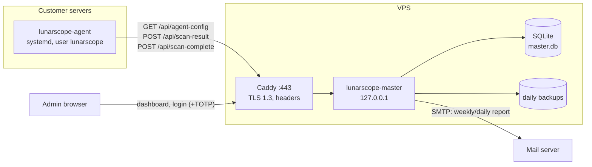
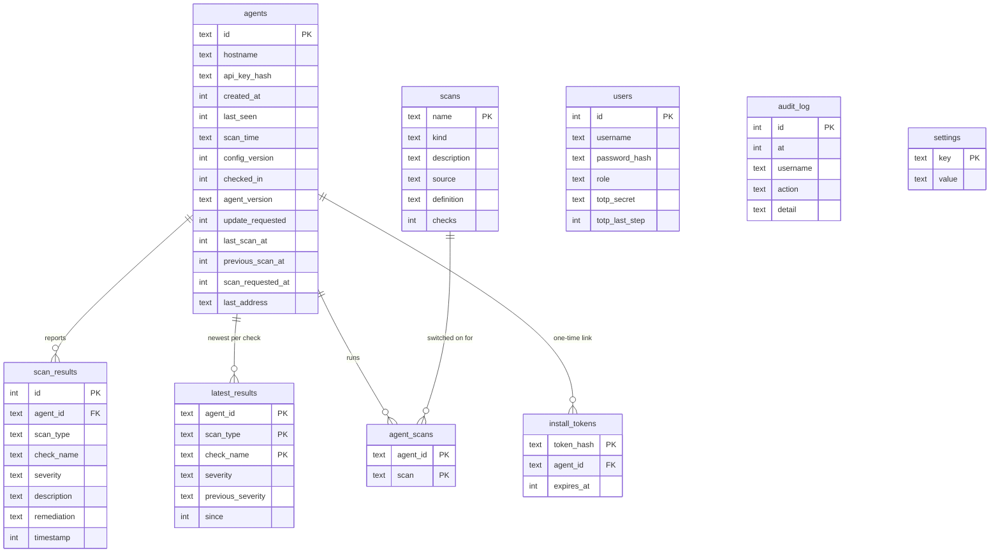

# Architecture as built (master 0.6.1, agent 0.4.1)

The architecture design document (`Architecture desing phase/architecture-design.pdf`,
17 Oct) describes the plan made before the building phase. This file describes
the system **as it is built now**, chapter by chapter in the same order, and
lists every place where the built system differs from the design, with the
reason. The core decisions (ADR-001 to ADR-004) still stand; what changed is
mostly *added* on top of them.

Checked against the code on 2026-11-23: `lunarscope-master` 0.6.1,
`lunarscope-agent` 0.4.1, `lunarscope-modules`.

## 1. Summary of the differences

| # | Design document | As built | Why |
|---|-----------------|----------|-----|
| D1 | Agent reads `[modules] enabled` and `interval_seconds` from `config.toml` (3.1.4, 6.3) | `config.toml` holds only `agent_id`, `api_key`, `master_url`. Which scans run and when comes from the master (`GET /api/agent-config`), polled by the agent | Change scans and scan time from the dashboard without logging in on every server |
| D2 | Scan every `interval_seconds` (3600) | One scan per day at a fixed time per agent (default 02:00), set on the Agents page in the master's time zone and sent to the agent as UTC; "Scan now" for an extra scan | Daily is enough for updates/config and spreads load; agent 0.2.0 |
| D3 | One endpoint `POST /api/scan-result` (3.2.3, 5.2) | 5 agent/admin API endpoints + the dashboard routes (section 5) | Agent management, self-update, stale findings, health check |
| D4 | Appendix B: one request with a `findings[]` array, 422 for bad JSON | 5.2 is what is built: one finding per request, flat body; bad JSON is 400, too big 413 | Appendix B contradicted 5.2; 5.2 was followed |
| D5 | API key stored as bcrypt/argon2 hash (5.3) | SHA-256 (hex) of the key | The key is 256 random bits, so a slow hash adds nothing; it would only slow every request. Argon2id *is* used for dashboard passwords |
| D6 | Key revocation "by changing the database" (5.3) | Dashboard: new install link / remove agent; the old key stops working | No database access needed |
| D7 | 2 tables (4.2) | 9 tables (section 4) | Users, audit log, settings, scans, install links, latest results |
| D8 | Data kept forever, retention "out of scope" (4.3) | History older than `--keep-days` (default 90) deleted daily; daily `VACUUM INTO` backup, newest `--backups` (7) kept | Needed for a real install; cheap to build |
| D9 | TLS 1.3 by the master with certbot (5.5, 6.4) | The master listens on `127.0.0.1` with plain HTTP; **Caddy** in front does TLS 1.3 (automatic Let's Encrypt) and security headers (`install/Caddyfile`) | No TLS code or certificate handling in the master; Caddy renews certificates itself |
| D10 | Master configured with `--config master.toml` (6.4) | Command-line options (`--db`, `--listen`, `--admin-token-file`, `--password-file`, `--public-url`, `--agent-binary`, `--keep-days`, `--backups`, `--backup-dir`) + settings in the database (Settings page) | Few options; the rest is changed in the dashboard |
| D11 | Dashboard without login, "internal network" (Appendix B) | Login with user name + password (Argon2id), roles admin/viewer, lockout per IP, optional two-step login (TOTP) with recovery key, audit log | The master is reachable from the internet (agents connect to it) |
| D12 | Dashboard routes `/agent/:id`, `/agent/:id/history` (Appendix B) | `/`, `/server/{id}`, `/agents`, `/scans`, `/report`, `/settings/*`, `/account` | Pages grouped by task, not by table |
| D13 | New module = edit `modules/mod.rs` + enable in `config.toml` (3.3.4) | Built-in modules as designed (trait + registration), **plus rule scans**: new checks written as TOML on the master, run by the agent with a fixed set of test types; no agent rebuild | Add checks without a new agent release; no test type runs a command, so the master can't make agents run code |
| D14 | Agent installed by hand (6.3), "script is a could-have" | One-time install link from "Add agent" (`/install/{token}`): downloads the agent from the master, writes `config.toml`, installs the systemd service | Could-have built |
| D15 | No update mechanism | Signed self-update: releases signed offline (Ed25519), the master only passes the offer on; agent checks the signature twice, `apply-update` as root replaces the binary | A hacked master can't push other code or older versions |
| D16 | CI: semgrep, clippy, cargo audit (6.5); no build | gitleaks, semgrep, clippy, tests, `cargo audit` + `cargo deny`, release build | More checks; build is the start of CD |
| D17 | Master binary ~12 MB (2.2, ADR-002) | ~14.6 MB release binary (0.6.1) | PDF, e-mail (TLS), TOTP/QR, many more pages |
| D18 | Repository structure (Appendix A, 3.2.2) | See section 3 | Grew with the features |
| D19 | Modules repo with `open_ports.rs`, `world_writable_files.rs` (Appendix A) | Built-in modules: `ssh_scan`, `firewall_scan`, `package_scan`; other checks are rule scans | The three in 3.3.3 were built; the rest are easier as rules |

Not built from the design/research yet (open): NVD/OSV lookups for package
versions, and most extra checks from research SQ1 as built-in modules.

## 2. High-level architecture

Unchanged: agents on the customer's servers send findings over HTTPS to one
master; the master stores them in SQLite and serves the dashboard. Added:

- The master also **sends** things to the agent, but only as answers to the
  agent's own requests (configuration, update offer). The agent still only
  connects outbound; no port is opened on customer servers.
- **Caddy** sits in front of the master for TLS.
- The master sends a **scheduled e-mail report** (SMTP, PDF attached) and
  makes PDF reports.

## 3. Components

### 3.1 Agent (`lunarscope-agent` 0.4.1)

| File | Does |
|------|------|
| `main.rs` | Start, loop: poll the configuration, wait for the scan time, run the scans, send |
| `config.rs` | Load and check `config.toml` (`agent_id`, `api_key`, `master_url`; https required except localhost) |
| `remote.rs` | `GET /api/agent-config`: scan time, enabled scans, rule scan definitions, update offer |
| `rules.rs` | Runs rule scans with a fixed set of test types (no command execution) |
| `sender.rs` | `POST /api/scan-result` per finding, then `POST /api/scan-complete` per module |
| `update.rs` | Signed self-update (`update-keygen`, `update-sign`, `apply-update`) |

Flow per day: poll config (also between scans, so changes arrive without a
restart) → at the scan time run each enabled built-in module and rule scan →
send each finding with the API key and a timestamp → report the module
complete (the master drops checks that weren't reported any more).

### 3.2 Master (`lunarscope-master` 0.6.1)

| Area | Files |
|------|-------|
| API for agents | `routes/api.rs`, `routes/updates.rs`, `routes/install.rs`, `auth.rs` |
| Dashboard | `routes/{dashboard,server,agents,scans,report,settings,users,account,email,login}.rs`, `templates/*.html` (Tera + HTMX) |
| Login & security | `session.rs` (sessions, lockout, pending two-step logins), `totp.rs`, `audit.rs` |
| Data | `db/{mod,queries,users}.rs`, `migrations/0001–0009` |
| Background tasks | `maintenance.rs` (cleanup + backup), `email.rs` (scheduled report) |
| Output | `report_pdf.rs` (report PDF, recovery key PDF), `i18n.rs` (EN/NL) |
| Rules & updates | `rule_scans.rs`, `updates.rs` |

### 3.3 Modules (`lunarscope-modules`)

The `ScanModule` trait (`name`, `description`, `run() -> Vec<Finding>`, `Send +
Sync`) and `Finding`/`Severity` are as in 3.3.1–3.3.2 of the design. Built in:
`ssh_scan`, `firewall_scan`, `package_scan`. Which ones run is no longer read
from `config.toml` but comes from the master (D1).

## 4. Data (9 tables)

- `agents` and `scan_results` are the two tables of the design, extended.
  `scan_results` is the full history; the dashboard reads `latest_results`.
- Secrets are never stored in plain text: API keys and install tokens as
  SHA-256, passwords as Argon2id. The TOTP secret is stored as is (it has to
  be, to compute codes); it doubles as the recovery key.
- `settings` holds the time zone, time format, theme, PDF theme, require
  two-step login, and the e-mail report settings (including the SMTP
  password; the file is only readable by the `lunarscope` user).
- Retention: see D8.

## 5. Communication

### 5.1 Agent API (over HTTPS via Caddy; the agent endpoints use `Authorization: Bearer <api_key>`)

| Endpoint | Purpose | Since |
|----------|---------|-------|
| `POST /api/scan-result` | One finding, body as design 5.2; timestamp within ±60 s (replay protection, as 5.4); 200/400/401/413/500 | step 25 |
| `POST /api/scan-complete` | Checks a module reported in a full scan; others are removed from the dashboard | 0.3.0 |
| `GET /api/agent-config` | Scan time, scans, rule definitions, update offer; records version and last contact | 0.3.0 |
| `GET /downloads/lunarscope-agent` | Agent binary for install (from `--agent-binary`) | 0.3.0 |
| `GET /install/{token}` | One-time install script | 0.3.0 |
| `POST /api/register-agent` | Admin token (`--admin-token-file`): register an agent without the dashboard | step 27 |
| `GET /healthz` | Monitoring | 0.4.0 |

### 5.2 Dashboard

Session cookie (`HttpOnly; Secure; SameSite=Strict`) after login; password
(Argon2id) and, when turned on, a 6-digit TOTP code (RFC 6238, ±30 s, each
code once) or the recovery key. Wrong passwords and codes count per IP (lockout).
Roles: `admin` (everything) and `viewer` (read-only + own account). Every
change goes to the audit log. Admins can require two-step login for everyone.

### 5.3 TLS

Caddy terminates TLS 1.3 (`protocols tls1.3`), gets Let's Encrypt
certificates itself and adds HSTS, `X-Frame-Options: DENY`,
`X-Content-Type-Options`, `Referrer-Policy`. The master only listens on
`127.0.0.1`. The agent refuses plain `http://` except for localhost.

## 6. Deployment

- **Master:** `/usr/local/bin/lunarscope-master` as systemd service
  `lunarscope-master.service` (user `lunarscope`, `StateDirectory`, strong
  sandboxing: `ProtectSystem=strict`, `SystemCallFilter`, no capabilities, …)
  behind Caddy. Database `/var/lib/lunarscope/master.db`.
- **Agent:** installed by the one-time install command; service
  `lunarscope-agent.service` with an `ExecStartPre=+… apply-update` step for
  self-update. Config `/etc/lunarscope/config.toml` (root:lunarscope, 640).
- **CI** (GitHub Actions, push to `develop`, `feature/**`, `fix/**`, PRs to
  `main`/`develop`): gitleaks, semgrep, clippy `-D warnings`, tests,
  `cargo audit` + `cargo deny`, release build.

## 7. ADRs

| ADR | Status now |
|-----|-----------|
| ADR-001 Rust for the agent | Still valid |
| ADR-002 Axum + SQLite + Tera/HTMX | Still valid; one binary. Caddy added in front only for TLS (D9) |
| ADR-003 HTTPS REST, pre-shared key, timestamp | Still valid; key hashed with SHA-256 instead of bcrypt/argon2 (D5) |
| ADR-004 Module trait | Still valid for built-in modules; extended with data-only rule scans (D13), which keep the "no code from the master" property |

New decisions taken during building (each documented in its change file):
configuration from the master instead of `config.toml` (D1), daily scan
time (D2), Caddy for TLS (D9), signed self-update with an offline key (D15),
rule scans without command execution (D13), user accounts + TOTP (D11).

## 8. Small inconsistencies found while checking

These are in the repositories now and are worth fixing:

1. ~~`lunarscope-master.service` listens on `127.0.0.1:3000`, but
   `install/Caddyfile` proxied to `127.0.0.1:3030`.~~ Fixed: the Caddyfile
   now uses 3000, and a test keeps both the same
   ([fix-0.6.1-caddy-port.md](phase-3-lunarscope-master/fix-0.6.1-caddy-port.md)).
2. ~~The semgrep job in CI ends in `|| true`, so findings never fail the build
   (the design says it "makes sure no unsafe code passes").~~ Fixed: `|| true`
   is removed in all three repositories after the findings were fixed (47, 18
   and 17 before, 0 after)
   ([fix-0.6.1-semgrep-blocking.md](phase-3-lunarscope-master/fix-0.6.1-semgrep-blocking.md)).
3. The agent API has no rate limit per IP (the dashboard login has one); the
   API key check and body limit (64 KiB) are the protection now.
4. ~~Dashboard forms have no CSRF token; they rely on `SameSite=Strict` cookies
   and POST-only changes.~~ Fixed: every change needs the session's CSRF token
   (header or form field), and logout too
   ([change-0.6.1-csrf-tokens.md](phase-3-lunarscope-master/change-0.6.1-csrf-tokens.md)).
