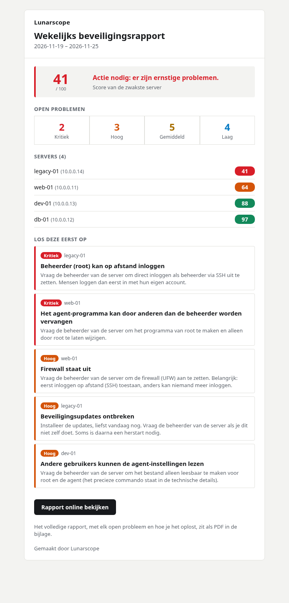
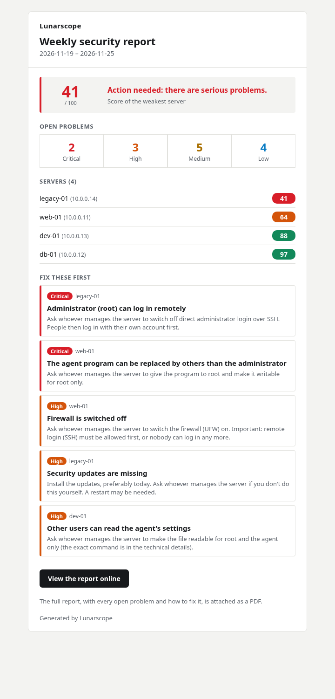

# Change (0.7.1) — the weekly report as an HTML mail

**Repo:** `lunarscope-master` 0.7.1
**Date:** 2026-11-25
**Status:** Done — code, tests, visual check, mutation checks; sending with
a real SMTP server worked earlier with the plain mail, the HTML version was
not sent to a real mailbox; not committed yet

## Why

The e-mailed report was plain text: a list of lines with the score and the
problems. The user asked for a clearer mail. A mail that shows the verdict,
the numbers and what to fix at a glance is more useful than text that has to
be read line by line.

## What the mail contains

The 600 px wide mail has these parts, top to bottom (function `html_summary`
in `src/email.rs`):

1. **Header:** "Lunarscope", the report title and the period.
2. **Verdict box:** the score of the weakest server (`/ 100`) and the verdict
   text; the left border and the score have the colour of the verdict
   (`verdict_class`: ok green, warn orange, otherwise red). When no server has
   a result yet there is no score, only the verdict.
3. **Open problems:** four cells with the number per severity (Critical, High,
   Medium, Low).
4. **Servers (n):** one row per server with a coloured score pill and the
   address in brackets.
5. **Fix these first:** one card per urgent finding: severity badge, server,
   the title of the finding and, when it exists, the plain advice from the
   text `fix_<check>`. At most 10 cards, then "+N (see the PDF)". Without
   urgent findings the mail says that nothing is urgent.
6. **Button** "View the report online" (new text `email_open_online`, EN and
   NL), only when the master has a public URL.
7. **Footer:** the PDF is attached, generated by Lunarscope.

`message()` now builds `multipart/mixed` with a `multipart/alternative`
(text/plain = the old `summary`, text/html = `html_summary`) and the PDF as
attachment.

## Design decisions

- **multipart/alternative with the text as fallback.** Mail programs without
  HTML (or with HTML switched off) show the old text; the others show the HTML
  part, which comes last as the standard asks.
- **Tables and inline styles.** Many mail programs drop `<style>` blocks and
  do not support flexbox or grid; nested tables with `style=""` look the same
  everywhere.
- **No images, no scripts.** Nothing is loaded from outside, so there is
  nothing for a mail program to block (and no tracking); the score pills and
  badges are plain coloured text.
- **Everything escaped, URLs too.** `esc()` replaces `& < > " '`; host names,
  descriptions, the period and the report URL (which sits in an `href`) all go
  through it, so a finding with `<script>` or a quote in a URL cannot change
  the mail.
- **The light colours of the dashboard** (the same as the PDF and
  `templates/base.html`), because a mail has a white background in most
  programs.
- **One source of text.** The same i18n texts and `finding_title` as the PDF
  are used, so the mail and the report say the same.

| Part | Where |
|------|-------|
| `esc`, colour constants, `severity_colour`, `class_colour`, `html_summary` | `src/email.rs` |
| `message()` with `multipart/alternative` | `src/email.rs` |
| Text `email_open_online` (EN "View the report online", NL "Rapport online bekijken") | `src/i18n.rs` |

No new crates (the alternative part is in `lettre`) and no migration.

## Tests

Master **375** tests, all passing (`cargo fmt --check` and clippy clean).

| Test | Area |
|------|------|
| `email::tests::the_mail_has_an_html_part_next_to_the_text` | structure: mixed, alternative, text before HTML, PDF |
| `email::tests::the_html_mail_shows_verdict_counts_servers_and_what_to_fix` | verdict, counts, servers, advice, no script or image, button only with URL |
| `email::tests::everything_in_the_html_mail_is_escaped` | escaping of host, description, period, URL; cut after 10 |
| `email::tests::without_urgent_problems_the_mail_says_so` (extended) | no urgent findings |
| `email::tests::the_verdict_box_has_the_colour_of_its_verdict` | added after mutation 5 (see below) |

## Visual check

Rendered with headless Chromium at 720 px width, with a sample of 4 servers
(41, 64, 88, 97) and 5 urgent findings, and again in a 375 px phone viewport:
no horizontal scroll.

Dutch:

English:

### Mutation checks

Each deliberate bug applied, the whole `cargo test` run, `src/email.rs`
restored afterwards (checked with `cmp`).

| # | Mutation | Result |
|---|----------|--------|
| 1 | `esc()` does not escape `<` | caught: `everything_in_the_html_mail_is_escaped` |
| 2 | URL in `href` without `esc()` | caught: `everything_in_the_html_mail_is_escaped` and `the_html_mail_shows_verdict_counts_servers_and_what_to_fix` |
| 3 | `message()` only the text part (no alternative) | caught: `the_mail_has_an_html_part_next_to_the_text` |
| 4 | no cut after `MAIL_LINES` (all urgent findings) | caught: `everything_in_the_html_mail_is_escaped` |
| 5 | verdict colour always green | **survived at first** (the test only looked for the orange border, which the High card has too); added `the_verdict_box_has_the_colour_of_its_verdict`; re-run: caught |
| 6 | score shown when no server is scored | caught: `everything_in_the_html_mail_is_escaped` |
| 7 | the fix advice is never added | caught: `the_html_mail_shows_verdict_counts_servers_and_what_to_fix` |

6 of 7 caught at once; 1 survived and is caught after one extra test.

### Not tested

The HTML mail was **not sent to a real mailbox**, so how Gmail, Outlook or
Apple Mail show it is not checked (only Chromium). Sending itself through a
real SMTP server worked earlier with the plain mail.
